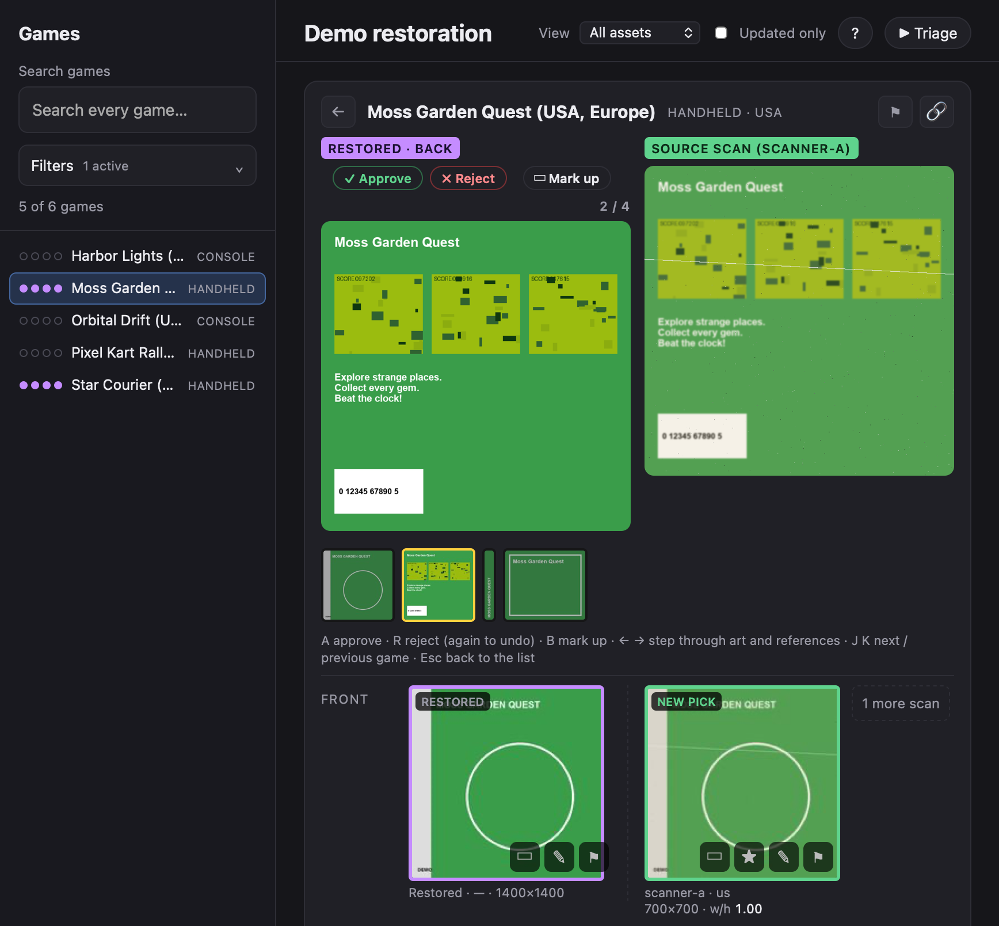

# boxart-restoration-kit

Point a team of AI agents at a pile of worn, blurry box-art scans — covers, backs, spines, cartridge or disc labels for
any platform — and review their restorations yourself, fast. The kit is the workflow that sits between you and the
agents:

- **A review page** where you judge every restored asset: approve (A), reject (R), or draw boxes over what's wrong and
  say why ("blurry", "artifacts", …). Compare restored ↔ original in place with the arrow keys. It updates live while
  agents work, and every game and asset has its own link.
- **A fix queue** built from your judgements, most important first. Reviewer agents claim games from it (each game is
  locked to one reviewer), so you can run one reviewer or several without them colliding.
- **A check that agents can't talk their way past** (`restore_check.py`): reads the model that really ran from the
  agent's own transcript, fails if a web reference the agent looked at wasn't saved, checks sizes, aspect ratio and
  white padding, and fingerprints the files so a reviewer can't hand back something that changed after the check.
- **Agent briefs and a skill** for three roles — orchestrator, reviewer, restorer — that work with Codex, Claude Code,
  Addy or anything that can start agents and run shell commands.

Nothing here generates images itself: your agents use whatever image tools they have. The kit makes their work
reviewable, repeatable and hard to fake.



## How it works

```
 you ── judge on the review page ──► approvals.json / rereview.json (boxes + notes)
                                            │
                                   tools/fix_queue.py build  (automatic, live)
                                            ▼
 orchestrator ─ starts ─► reviewer S1, S2… ─ claim ─► fix queue ─► job (your notes, box crops, scans on disk)
                               │                                        │
                               └── sends job ─► restorer helpers ── restore, then tools/restore_check.py
                               ◄── reply + CHECK PASS ──┘
                     review → restore_check --verify → fix_queue done ──► back on your review page
```

## Try it (5 minutes, made-up data)

```sh
pip install pillow                                   # the only dependency (Python 3.9+)
python3 examples/demo/make_demo.py                   # 6 made-up games with placeholder "scans"
python3 tools/review_server.py --config examples/demo/kit.json
# open http://127.0.0.1:8795/
```

Open a game, press **B** to mark up the restored front, drag a box, press **L** (blurry) and **Esc**. Then:

```sh
python3 tools/fix_queue.py board --config examples/demo/kit.json
python3 tools/fix_queue.py claim S1 --config examples/demo/kit.json
```

## Use it on your own project

1. **Make a project folder** with a `kit.json` (start from `examples/demo/kit.json` or `examples/gameboy/kit.json`):
   platforms (with their screen size, used for rebuilding screenshots), asset types and their minimum sizes, folders,
   regions, and your **edition rule** — printed at the top of every job.
2. **Put your scans** under the art folder and **describe them in `<work>/catalog.json`**:
   ```json
   {"games": [
     {"platform": "gb", "id": "Some Game (USA)", "region": "USA",
      "assets": {"front": [{"path": "scans/source-a/gb/Some Game (USA)/front.jpg", "source": "source-a", "region": "us", "use": true},
                           {"path": "scans/source-b/...", "source": "source-b", "region": "eu"}],
                 "back": [...], "spine": [...], "label": [...]}}
   ]}
   ```
   `use: true` marks the scan the restoration starts from (default: the first). Outputs go to
   `<restored>/<platform>/<game id>/<asset>.png`.
3. **Run the review server** (`python3 tools/review_server.py --config kit.json`) and open the page.
4. **Install the skill** for your agents (`docs/RUNTIMES.md`) and start them:
   *"Use the restoration skill. You are the orchestrator. Run 2 reviewers."*
5. **Judge.** Triage mode (▶ Triage) walks you through every restored asset; the queue refills itself from your
   rejections and boxes, and fixed assets come back to you.

## Review page keys
| Key | |
|---|---|
| A / R | approve / reject the asset being viewed (again to undo) — then on to the next |
| B | mark up: draw boxes over what's wrong; Esc saves (and rejects, and moves on) |
| L | fill in "blurry" for the selected box (or the whole image) |
| ← → | in the viewer: step through restored assets and references · in the zoom editor: flip restored ↔ original |
| J K | next / previous game · Esc: back to the list |
| Q | the fix queue: handed back (latest first), being fixed, up next, on hold |

## Files
| | |
|---|---|
| `tools/review_server.py` | the review page, judgements API, reference saver, live updates |
| `tools/build_page_data.py` | catalog + outputs → page data (run automatically by the server) |
| `tools/fix_queue.py` | the queue: `build`, `claim`, `show`, `done`, `release`, `status`, `board` |
| `tools/restore_check.py` | the check / `--verify` gate; writes `provenance.json` |
| `tools/compare.py` | side-by-side comparison with detail crops |
| `agents/` | `ORCHESTRATOR.md`, `REVIEWER.md`, `RESTORER.md`, and `SKILL.md` |
| `docs/RUNTIMES.md` | Codex, Claude Code, Addy: installing the skill, sandboxes, transcripts |
| `examples/` | `demo/` (made-up data), `gameboy/` (a real-world config + platform notes) |

## A note on copyright
Box art, scans and ROMs are copyrighted by their owners. This repository contains none — only tools and generated
placeholder images. Keep your art, outputs and work folders out of any public repository you build on top of this.

## License
MIT — see `LICENSE`.
